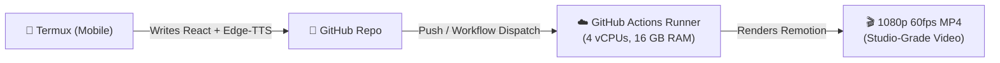

# 🌌 Vox-Style Space Motion Graphics Engine

> **Cloud-Rendered Programmatic Video Engine** powered by **Remotion (React + TypeScript)** & **GitHub Actions (4-core, 16 GB RAM Cloud Runner)**.

---

## 🎯 Architecture



- **Zero Phone RAM Load**: Rendering never touches your mobile device.
- **5-Layer Motion Design**: Ambient mesh $\to$ SVG assets $\to$ Kinetic Typography $\to$ Color grade $\to$ Animated film grain.
- **Deterministic Word Sync**: Millisecond-accurate word boundaries synthesized via Microsoft Edge-TTS.

---

## 🚀 1-Click Cloud Render Instructions

1. **Create a new GitHub Repository** (e.g. `vox-video-engine`).
2. **Push your code**:
   ```bash
   git remote add origin https://github.com/<YOUR_USERNAME>/vox-video-engine.git
   git branch -M main
   git push -u origin main
   ```
3. **Download Video**:
   - Go to your GitHub repository $\to$ Click on **Actions** tab.
   - The workflow **"Render Vox Video on 16GB Cloud"** will automatically start on push (or click **Run workflow**).
   - Once completed (~60–90 seconds), scroll down to **Artifacts** and download `vox-space-video-1080p.zip` containing `video.mp4`!
